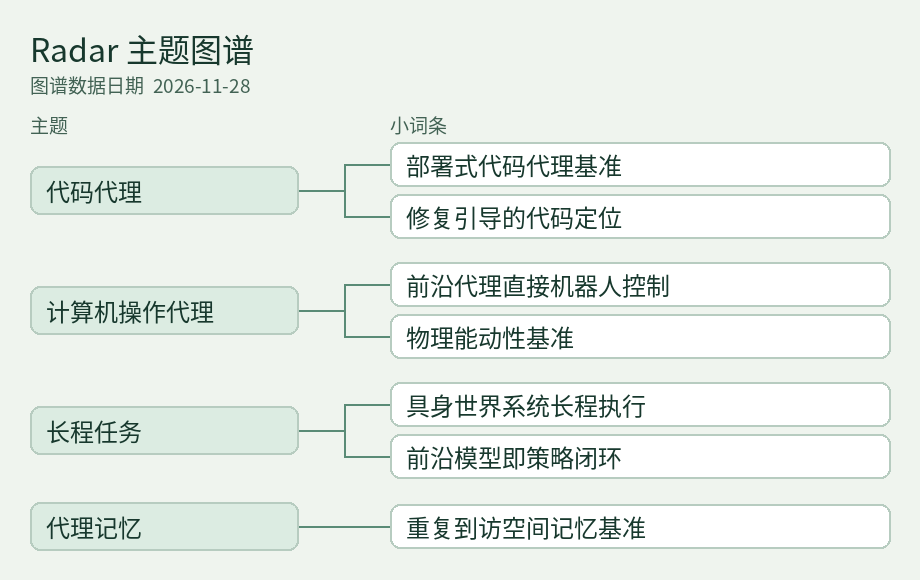

# Radar 主题图谱

[研究日报](inbox/) · [公司日报](company/) · [学习周报](weekly/)

图谱数据日期 **2026-11-28**。每周整理完成后更新。展开主题即可查看小词条和原文。

## 主题与原文

代码代理（2 个小词条）

### 部署式代码代理基准

- [Moving Generality from Model to Modeler: LLM Agents for PHM on a Deployment-Style Benchmark](https://huggingface.co/papers/2611.25252) · 发布 2026-11-23 · 收录 2026-11-28

### 修复引导的代码定位

- [Let the Fixer Decide: Training a Code Localizer from the Fixer's Likelihood](https://huggingface.co/papers/2611.12164) · 发布 2026-11-24 · 收录 2026-11-25

计算机操作代理（2 个小词条）

### 前沿代理直接机器人控制

- [AgentRoboCritic: Understanding the Capability of Frontier Agents on Direct Robot Control](https://arxiv.org/abs/2611.26613v1) · 发布 2026-11-19 · 收录 2026-11-21 · [其他来源 2](https://huggingface.co/papers/2611.26613)

### 物理能动性基准

- [WorldLeague: Benchmarking Physical Agency](https://huggingface.co/papers/2611.30989) · 发布 2026-11-24 · 收录 2026-11-25

长程任务（2 个小词条）

### 具身世界系统长程执行

- [Innata-0: A Native Embodied World System with Model-Agent Co-Design](https://huggingface.co/papers/2611.30254) · 发布 2026-11-24 · 收录 2026-11-28

### 前沿模型即策略闭环

- [Embo-Harness: Towards Understanding Frontier-Model-as-Policy Harness](https://huggingface.co/papers/2611.31201) · 发布 2026-11-24 · 收录 2026-11-25

代理记忆（1 个小词条）

### 重复到访空间记忆基准

- [Lost in the Hallway: Benchmarking Persistent Spatial Memory Across Revisits](https://huggingface.co/papers/2611.21485) · 发布 2026-11-23 · 收录 2026-11-24

